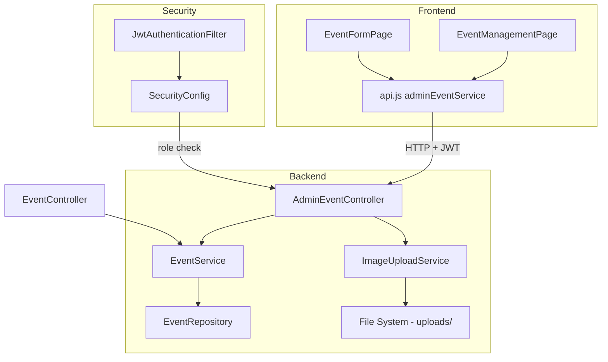

# Design Document: Event Management

## Overview

The Event Management feature extends RainCheque's existing read-only event endpoints with full CRUD operations, image upload, category filtering, combined search with pagination, and an admin UI. The backend introduces a new `AdminEventController` under `/api/v1/admin/events` with role-based access (VENUE_ADMIN, ADMIN), while the existing `EventController` remains unchanged for public consumers. The frontend adds two new lazy-loaded admin pages: an event list with filters and an event form with image upload previews.

### Design Decisions

1. **Separate admin controller** rather than adding admin methods to the existing `EventController` — keeps public and admin concerns isolated, simplifies security configuration, and avoids polluting the public API path.
2. **File-system image storage** using the existing `app.upload.dir` configuration — avoids introducing external dependencies (S3, CDN) for the MVP. Files are served via a Spring static resource handler.
3. **Jakarta Validation annotations** on request DTOs — leverages Spring's built-in validation pipeline and integrates with the existing `GlobalExceptionHandler` for field-level error responses.
4. **Spring Data Pageable** for all list endpoints — consistent with existing patterns in `EventController` and `EventService`.

---

## Architecture



### Request Flow

1. Frontend sends authenticated request with JWT in `Authorization` header
2. `JwtAuthenticationFilter` validates token and sets `SecurityContext`
3. `SecurityConfig` enforces role-based access on `/api/v1/admin/**` paths
4. `AdminEventController` delegates to `EventService` or `ImageUploadService`
5. Response flows back through the controller as a DTO

---

## Components and Interfaces

### Backend Components

#### AdminEventController

```
POST   /api/v1/admin/events                 → createEvent(EventRequest) → EventResponse (201)
GET    /api/v1/admin/events                 → listEvents(page, size, status, category, search) → Page<EventResponse> (200)
GET    /api/v1/admin/events/{id}            → getEvent(id) → EventResponse (200)
PUT    /api/v1/admin/events/{id}            → updateEvent(id, EventRequest) → EventResponse (200)
PATCH  /api/v1/admin/events/{id}/status     → updateStatus(id, StatusRequest) → EventResponse (200)
DELETE /api/v1/admin/events/{id}            → deleteEvent(id) → (204)
POST   /api/v1/admin/events/{id}/images     → uploadImage(id, file, target) → ImageUploadResponse (200)
```

#### ImageUploadService

- `uploadImage(MultipartFile file, String target)` → validates content type and size, generates unique filename (UUID + original extension), stores to `${app.upload.dir}/events/`, returns relative URL
- Allowed types: `image/jpeg`, `image/png`, `image/webp`
- Max size: 5 MB
- Filename format: `{uuid}.{extension}`

#### EventService (extended)

- `getAllEventsAdmin(Pageable, EventStatus, String category, String search)` → returns all events with optional filters, sorted by creation date descending
- `searchEventsWithFilters(String keyword, String category, LocalDateTime from, LocalDateTime to, Pageable)` → combined search with all filters
- Existing methods remain unchanged

#### EventRepository (extended)

- `findAllWithFilters(EventStatus status, String category, String keyword, Pageable pageable)` → dynamic query with optional predicates
- `findDistinctCategoriesByStatus(EventStatus status)` → categories from published events only

#### SecurityConfig (updated)

Add authorization rule:
```java
.requestMatchers("/api/v1/admin/**").hasAnyRole("VENUE_ADMIN", "ADMIN")
.requestMatchers("/uploads/**").permitAll()
```

#### Static resource handler

Configure `WebMvcConfigurer` to serve `/uploads/**` from `file:${app.upload.dir}/` for image access.

### Frontend Components

#### Pages

| Page | Route | Description |
|------|-------|-------------|
| EventManagementPage | `/admin/events` | Paginated event list with search, category filter, status filter |
| EventFormPage | `/admin/events/new` | Create event form |
| EventFormPage | `/admin/events/:id/edit` | Edit event form (same component, pre-filled) |

#### Shared Components

- `AdminRoute` — wraps `ProtectedRoute` with additional role check (VENUE_ADMIN or ADMIN)
- `ImageUploader` — drag-and-drop/click file input with preview, client-side type/size validation
- `PaginationControls` — page navigation reflecting current state
- `EventFilters` — search input, category dropdown, status dropdown

#### API Service Extension (api.js)

```javascript
export const adminEventService = {
  list: (params) => api.get('/admin/events', { params }),
  get: (id) => api.get(`/admin/events/${id}`),
  create: (data) => api.post('/admin/events', data),
  update: (id, data) => api.put(`/admin/events/${id}`, data),
  updateStatus: (id, status) => api.patch(`/admin/events/${id}/status`, { status }),
  delete: (id) => api.delete(`/admin/events/${id}`),
  uploadImage: (id, file, target) => {
    const formData = new FormData();
    formData.append('file', file);
    formData.append('target', target);
    return api.post(`/admin/events/${id}/images`, formData, {
      headers: { 'Content-Type': 'multipart/form-data' }
    });
  }
};
```

---

## Data Models

### Request DTOs

#### EventRequest

```java
public record EventRequest(
    @NotBlank @Size(min = 3, max = 200) String title,
    @Size(max = 10000) String description,
    @Size(max = 500) String shortDescription,
    @NotNull Long venueId,
    @NotNull @Future(message = "Start time must be in the future") LocalDateTime startTime,
    @NotNull LocalDateTime endTime,
    @NotBlank String category,
    Boolean featured,
    Event.EventMetadata metadata
) {}
```

Custom validation: `@ValidTimeRange` annotation on class level ensures `endTime > startTime`.

#### StatusRequest

```java
public record StatusRequest(
    @NotNull Event.EventStatus status
) {}
```

#### ImageUploadResponse

```java
public record ImageUploadResponse(
    String url,
    String filename,
    String target
) {}
```

### Response DTOs

The existing `EventResponse` is reused for admin endpoints. It already contains all fields (status, metadata, ticketTiers, etc.) needed for admin views.

### Pagination Response

Spring Data `Page<EventResponse>` already serializes as:
```json
{
  "content": [...],
  "totalElements": 42,
  "totalPages": 5,
  "number": 0,
  "size": 10,
  ...
}
```

### Validation Annotations Summary

| Field | Constraint | Message |
|-------|-----------|---------|
| title | @NotBlank, @Size(3, 200) | "Title must be between 3 and 200 characters" |
| description | @Size(max=10000) | "Description must not exceed 10000 characters" |
| shortDescription | @Size(max=500) | "Short description must not exceed 500 characters" |
| venueId | @NotNull | "Venue is required" |
| startTime | @NotNull, @Future | "Start time must be in the future" |
| endTime | @NotNull | "End time is required" |
| category | @NotBlank | "Category is required" |

---

## Correctness Properties

*A property is a characteristic or behavior that should hold true across all valid executions of a system — essentially, a formal statement about what the system should do. Properties serve as the bridge between human-readable specifications and machine-verifiable correctness guarantees.*

### Property 1: Event creation always produces DRAFT status

*For any* valid event creation request submitted by an authorized user, the persisted event SHALL have status DRAFT regardless of any other input values.

**Validates: Requirements 1.1**

### Property 2: Validation rejects invalid requests with all errors collected

*For any* event request (create or update) with one or more invalid fields (missing required fields, out-of-range lengths, blank category), the validator SHALL reject the request and the error response SHALL contain a field-level error for every invalid field — not just the first one encountered.

**Validates: Requirements 1.2, 3.2, 9.6**

### Property 3: Time range validation

*For any* event request where endTime is less than or equal to startTime, the validator SHALL reject the request regardless of all other field values.

**Validates: Requirements 1.5, 9.5**

### Property 4: Field constraint enforcement

*For any* string value for title with length outside [3, 200], or description exceeding 10000 characters, or shortDescription exceeding 500 characters, or category that is blank/whitespace-only, the validator SHALL reject the event request.

**Validates: Requirements 9.1, 9.2, 9.3, 9.7**

### Property 5: Event visibility matches PUBLISHED status

*For any* event in the system, the event SHALL appear in public listing endpoints if and only if its status is PUBLISHED. Events with status DRAFT, CANCELLED, or COMPLETED SHALL NOT appear in public listings.

**Validates: Requirements 3.3, 3.4**

### Property 6: Admin listing returns all events regardless of status

*For any* set of events with any combination of statuses (DRAFT, PUBLISHED, CANCELLED, COMPLETED), the admin list endpoint SHALL return all of them, sorted by creation date descending.

**Validates: Requirements 2.1**

### Property 7: Update round-trip preserves data

*For any* valid update request applied to an existing event, reading that event back SHALL return field values matching the update request for all mutable fields.

**Validates: Requirements 3.1**

### Property 8: Delete removes event from existence

*For any* existing event, after a successful delete operation, querying for that event by ID SHALL produce a 404 response.

**Validates: Requirements 4.1**

### Property 9: Image upload type validation

*For any* file upload where the content type is NOT one of image/jpeg, image/png, or image/webp, the Image_Upload_Service SHALL reject the upload. *For any* file with an allowed content type and size ≤ 5 MB, the upload SHALL succeed.

**Validates: Requirements 5.1, 5.2**

### Property 10: Unique filename generation

*For any* set of N image uploads (even with identical original filenames), the Image_Upload_Service SHALL produce N distinct stored filenames with zero collisions.

**Validates: Requirements 5.4**

### Property 11: Category listing reflects published events only

*For any* set of events in the system, the categories endpoint SHALL return exactly the set of distinct category values from events with PUBLISHED status — no more, no less.

**Validates: Requirements 6.1**

### Property 12: Category filter returns only matching published events

*For any* category filter value, all events returned by the filter endpoint SHALL have that exact category AND status PUBLISHED.

**Validates: Requirements 6.2**

### Property 13: Case-insensitive search across fields

*For any* keyword string, searching with that keyword in any case variation (upper, lower, mixed) SHALL return the same set of results, and results SHALL include events where the keyword matches title, description, or venue name.

**Validates: Requirements 7.1, 7.4**

### Property 14: Combined filters conjunctively applied

*For any* search request with keyword, category, and date filters, every event in the result set SHALL satisfy ALL filter conditions simultaneously.

**Validates: Requirements 7.2**

### Property 15: Pagination metadata consistency

*For any* paginated response, the pagination metadata SHALL satisfy: `totalPages == ceil(totalElements / pageSize)` and `content.length <= pageSize` and `currentPage == requested page number`.

**Validates: Requirements 8.2**

---

## Error Handling

### Backend Error Strategy

All errors flow through the existing `GlobalExceptionHandler`. New scenarios:

| Scenario | Exception | HTTP Status | Response |
|----------|-----------|-------------|----------|
| Validation failure | `MethodArgumentNotValidException` | 400 | ErrorResponse with fieldErrors |
| Event not found | `ResourceNotFoundException` | 404 | ErrorResponse with message |
| Unauthorized (no JWT) | Spring Security | 401 | ErrorResponse |
| Forbidden (wrong role) | `AccessDeniedException` | 403 | ErrorResponse |
| Invalid file type | `InvalidFileTypeException` (new) | 400 | ErrorResponse with allowed types |
| File too large | `FileSizeLimitExceededException` (new) | 400 | ErrorResponse with max size |
| File storage failure | `FileStorageException` (new) | 500 | ErrorResponse (sanitized in prod) |

### Frontend Error Strategy

- API errors caught by Axios interceptor → 401 triggers logout
- Form validation errors extracted from `response.data.fieldErrors` and mapped to individual form fields
- Network errors display a toast/banner message
- Image upload errors shown inline beneath the upload control

---

## Testing Strategy

### Backend Testing

**Unit Tests (JUnit 5 + Mockito)**
- `AdminEventController`: verify correct HTTP status codes, delegation to service
- `EventService` extended methods: verify business logic with mocked repository
- `ImageUploadService`: verify file validation, unique naming, storage delegation
- Custom validator (`@ValidTimeRange`): verify time comparison logic

**Property-Based Tests (jqwik)**
- Library: [jqwik](https://jqwik.net/) (already in the project's `.jqwik-database` file indicates prior use)
- Minimum 100 iterations per property test
- Each test tagged with: `// Feature: event-management, Property {N}: {description}`
- Properties to implement:
  - Property 1: DRAFT status on creation
  - Property 2: All validation errors collected
  - Property 3: Time range validation
  - Property 4: Field constraint enforcement
  - Property 7: Update round-trip
  - Property 9: Image type validation
  - Property 10: Unique filename generation
  - Property 13: Case-insensitive search
  - Property 15: Pagination metadata consistency

**Integration Tests (Spring Boot Test + MockMvc)**
- Security: verify 401/403 responses for unauthorized access (Requirements 1.3, 1.4, 4.3, 4.4)
- End-to-end CRUD flow with H2 database
- Image upload/serve round-trip
- Pagination edge cases (empty results, beyond-range page)

### Frontend Testing

**Unit Tests (Vitest + React Testing Library)**
- EventFormPage: form rendering, field presence, inline validation display, submit behavior
- EventManagementPage: list rendering, filter controls, pagination controls
- ImageUploader: type/size validation, preview display
- AdminRoute: role-based access control

**Integration Tests**
- Full create/edit flow with mocked API
- Image upload with preview and error handling
- Pagination navigation
- Responsive layout verification at breakpoints
