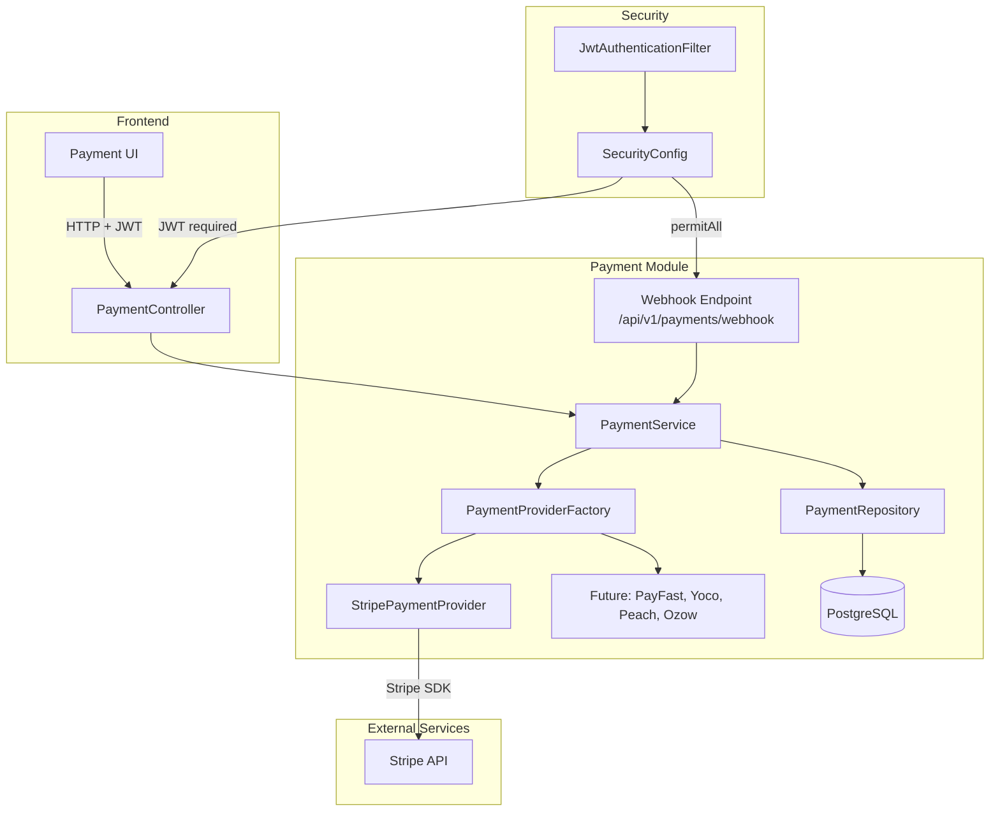
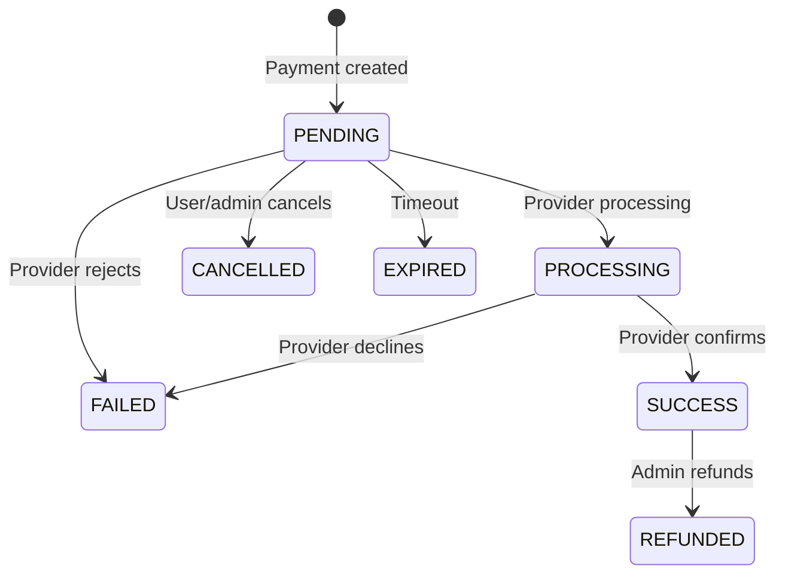

# Design Document: Payment Provider Abstraction

## Overview

The Payment Provider Abstraction module introduces a gateway-agnostic payment architecture to RainCheque using the Strategy and Factory patterns with Dependency Inversion. The initial implementation targets Stripe, with the architecture designed so that adding a new provider (PayFast, Yoco, Peach, Ozow) requires only a single new implementation class plus configuration — no changes to business logic, controllers, or the factory.

### Design Decisions

1. **Strategy Pattern + Factory Pattern** — Each payment gateway is a strategy implementing `PaymentProvider`. The `PaymentProviderFactory` resolves the correct strategy at runtime via Spring bean auto-discovery. This avoids switch statements and keeps the factory closed for modification.
2. **Dependency Inversion** — `PaymentService` depends on the `PaymentProvider` interface, never on concrete providers. Stripe SDK classes are confined to the `stripe` sub-package.
3. **Separate `payment` package** rather than mixing into existing packages — keeps the payment domain self-contained with its own controller, service, DTOs, entities, exceptions, and config. Follows the same modular pattern as the existing event management code.
4. **Platform DTOs at the boundary** — All provider methods accept/return platform-defined DTOs (`PaymentRequest`, `PaymentResponse`, `PaymentWebhookEvent`). Provider-specific types never leak beyond the provider implementation class.
5. **Webhook endpoints are public** — Webhook endpoints skip JWT authentication (providers can't authenticate). All other payment endpoints require JWT.
6. **Per-provider enable/disable** — Configuration supports enabling individual providers independently, validated at startup.

---

## Architecture



### Request Flow

1. Frontend sends authenticated request with JWT in `Authorization` header.
2. `JwtAuthenticationFilter` validates token and sets `SecurityContext`.
3. `SecurityConfig` enforces role-based access: authenticated for checkout/status, ADMIN for refunds.
4. `PaymentController` delegates to `PaymentService`.
5. `PaymentService` obtains the correct `PaymentProvider` from `PaymentProviderFactory`.
6. Provider executes the operation against the external gateway.
7. `PaymentService` persists/updates the `Payment` entity and returns the response.

### Webhook Flow

1. Payment gateway POSTs to `/api/v1/payments/webhook/{provider}` (public, no JWT).
2. `PaymentController` passes raw body + headers to `PaymentService`.
3. `PaymentService` obtains the provider via factory, calls `constructWebhookEvent` for signature verification and normalization.
4. The normalized `PaymentWebhookEvent` drives entity status updates.

---

## Components and Interfaces

### PaymentProvider Interface

```java
public interface PaymentProvider {
    PaymentResponse createCheckoutSession(PaymentRequest request) throws PaymentException;
    PaymentResponse verifyPayment(String paymentId) throws PaymentException;
    PaymentResponse refundPayment(String paymentId, BigDecimal amount) throws PaymentException;
    PaymentResponse cancelPayment(String paymentId) throws PaymentException;
    PaymentResponse retrievePayment(String paymentId) throws PaymentException;
    List<PaymentResponse> getPaymentHistory(String customerId) throws PaymentException;
    PaymentWebhookEvent constructWebhookEvent(String payload, String signatureHeader) throws PaymentException;
    PaymentProviderType getProviderType();
}
```

### PaymentProviderFactory

```java
@Component
public class PaymentProviderFactory {
    private final Map<PaymentProviderType, PaymentProvider> providers;

    // Constructor injection: Spring injects all PaymentProvider beans
    public PaymentProviderFactory(List<PaymentProvider> providerList, PaymentProperties properties) {
        this.providers = providerList.stream()
            .filter(p -> properties.isProviderEnabled(p.getProviderType()))
            .collect(Collectors.toMap(PaymentProvider::getProviderType, Function.identity()));
    }

    public PaymentProvider getProvider(PaymentProviderType type) {
        PaymentProvider provider = providers.get(type);
        if (provider == null) {
            throw new ProviderUnavailableException("Payment provider not available: " + type);
        }
        return provider;
    }
}
```

### PaymentService

```java
@Service
@Slf4j
public class PaymentService {
    private final PaymentProviderFactory providerFactory;
    private final PaymentRepository paymentRepository;

    // Key operations:
    // - initiateCheckout(PaymentRequest): creates payment entity (PENDING), delegates to provider
    // - verifyPayment(paymentId): queries provider, updates entity status
    // - processRefund(paymentId, amount): validates SUCCESS status, delegates refund, updates entity
    // - handleWebhook(providerType, payload, signature): verifies + normalizes, updates entity
    // - getPaymentStatus(paymentId): retrieves current payment state
}
```

### PaymentController

```
POST   /api/v1/payments/checkout              → initiateCheckout(PaymentRequest) → PaymentResponse (201)
GET    /api/v1/payments/{id}                   → getPaymentStatus(id) → PaymentResponse (200)
POST   /api/v1/payments/{id}/refund            → processRefund(id, RefundRequest) → PaymentResponse (200)
POST   /api/v1/payments/{id}/cancel            → cancelPayment(id) → PaymentResponse (200)
POST   /api/v1/payments/webhook/{provider}     → handleWebhook(provider, body, headers) → HTTP 200/400
```

### StripePaymentProvider

```java
@Component
@ConditionalOnProperty(name = "payment.stripe.enabled", havingValue = "true")
public class StripePaymentProvider implements PaymentProvider {
    // Encapsulates ALL Stripe SDK usage
    // Maps Stripe objects → platform DTOs
    // Maps Stripe exceptions → PaymentException
    // Verifies webhook signatures using configured secret
}
```

### SecurityConfig Updates

```java
.requestMatchers("/api/v1/payments/webhook/**").permitAll()  // webhooks are public
.requestMatchers("/api/v1/payments/*/refund").hasAnyRole("ADMIN")  // refunds require ADMIN
.requestMatchers("/api/v1/payments/**").authenticated()  // other payment ops require auth
```

---

## Data Models

### Enums

#### PaymentProviderType

```java
public enum PaymentProviderType {
    STRIPE, PAYFAST, YOCO, PEACH, OZOW
}
```

#### PaymentStatus

```java
public enum PaymentStatus {
    PENDING, PROCESSING, SUCCESS, FAILED, CANCELLED, REFUNDED, EXPIRED
}
```

**Valid Status Transitions:**



### Payment Entity

```java
@Entity
@Table(name = "payments")
@Data
@NoArgsConstructor
@EntityListeners(AuditingEntityListener.class)
public class Payment {

    @Id
    @GeneratedValue(strategy = GenerationType.IDENTITY)
    private Long id;

    @ManyToOne(fetch = FetchType.LAZY)
    @JoinColumn(name = "booking_id", nullable = false)
    private Booking booking;

    @Enumerated(EnumType.STRING)
    @Column(nullable = false)
    private PaymentProviderType provider;

    @Column(name = "provider_reference", unique = true)
    private String providerReference;  // External session/intent ID

    @Column(name = "provider_status")
    private String providerStatus;  // Raw status from provider

    @Column(name = "provider_transaction_id")
    private String providerTransactionId;

    @Enumerated(EnumType.STRING)
    @Column(nullable = false)
    private PaymentStatus status = PaymentStatus.PENDING;

    @Column(nullable = false, precision = 10, scale = 2)
    private BigDecimal amount;

    @Column(nullable = false, length = 3)
    private String currency;

    @CreatedDate
    @Column(name = "created_at", updatable = false)
    private LocalDateTime createdAt;

    @LastModifiedDate
    @Column(name = "updated_at")
    private LocalDateTime updatedAt;

    @Column(name = "paid_at")
    private LocalDateTime paidAt;

    @Column(name = "refunded_at")
    private LocalDateTime refundedAt;
}
```

### Request DTOs

#### PaymentRequest

```java
public record PaymentRequest(
    @NotNull Long eventId,
    @NotNull Long ticketId,
    @NotNull @DecimalMin(value = "0.01") BigDecimal amount,
    @NotBlank @Size(min = 3, max = 3) String currency,
    @NotBlank @URL String successUrl,
    @NotBlank @URL String cancelUrl,
    @NotBlank @Email String customerEmail,
    PaymentProviderType provider  // defaults to configured default if null
) {}
```

#### RefundRequest

```java
public record RefundRequest(
    @NotNull @DecimalMin(value = "0.01") BigDecimal amount,
    String reason
) {}
```

### Response DTOs

#### PaymentResponse

```java
public record PaymentResponse(
    Long paymentId,
    String checkoutUrl,
    String providerName,
    PaymentStatus status,
    BigDecimal amount,
    String currency,
    LocalDateTime createdAt,
    LocalDateTime paidAt,
    LocalDateTime refundedAt
) {}
```

#### PaymentWebhookEvent

```java
public record PaymentWebhookEvent(
    String eventType,        // e.g., "payment.completed", "payment.failed"
    String paymentId,        // Provider's payment/session ID
    PaymentProviderType provider,
    PaymentStatus status,    // Normalized platform status
    String rawPayload,       // Original payload for audit
    LocalDateTime timestamp
) {}
```

### Configuration

#### PaymentProperties

```java
@Configuration
@ConfigurationProperties(prefix = "payment")
@Validated
public class PaymentProperties {

    private Map<PaymentProviderType, ProviderConfig> providers = new EnumMap<>(PaymentProviderType.class);
    private PaymentProviderType defaultProvider = PaymentProviderType.STRIPE;

    @Data
    public static class ProviderConfig {
        private boolean enabled;
        private String apiKey;
        private String webhookSecret;
        // Provider-specific fields (merchantId, merchantKey, etc.)
        private Map<String, String> properties = new HashMap<>();
    }

    public boolean isProviderEnabled(PaymentProviderType type) {
        ProviderConfig config = providers.get(type);
        return config != null && config.isEnabled();
    }

    @PostConstruct
    public void validateCredentials() {
        // Validates that all enabled providers have required credentials
    }
}
```

**application.yml structure:**

```yaml
payment:
  default-provider: STRIPE
  providers:
    STRIPE:
      enabled: true
      api-key: ${STRIPE_API_KEY}
      webhook-secret: ${STRIPE_WEBHOOK_SECRET}
    PAYFAST:
      enabled: false
      properties:
        merchant-id: ${PAYFAST_MERCHANT_ID}
        merchant-key: ${PAYFAST_MERCHANT_KEY}
```

---

## Correctness Properties

*A property is a characteristic or behavior that should hold true across all valid executions of a system — essentially, a formal statement about what the system should do. Properties serve as the bridge between human-readable specifications and machine-verifiable correctness guarantees.*

### Property 1: Factory resolves registered providers correctly

*For any* enabled `PaymentProviderType` that has a registered implementation, the `PaymentProviderFactory` SHALL return a `PaymentProvider` whose `getProviderType()` matches the requested type.

**Validates: Requirements 2.1**

### Property 2: Factory rejects unavailable providers

*For any* `PaymentProviderType` that is either unregistered or disabled in configuration, the `PaymentProviderFactory` SHALL throw a `ProviderUnavailableException`.

**Validates: Requirements 2.2, 2.3, 8.3**

### Property 3: Stripe status mapping covers all provider statuses

*For any* Stripe payment status string returned by the Stripe API, the `StripePaymentProvider` SHALL map it to exactly one valid `PaymentStatus` enum value without throwing.

**Validates: Requirements 3.2**

### Property 4: Provider error sanitization

*For any* provider exception message (including those containing API keys, internal IDs, or stack traces), the resulting platform `PaymentException` message SHALL NOT contain API keys, webhook secrets, or provider-internal identifiers.

**Validates: Requirements 3.6, 9.2, 9.3**

### Property 5: Checkout always produces PENDING status

*For any* valid `PaymentRequest`, after `PaymentService.initiateCheckout` completes successfully, the persisted `Payment` entity SHALL have status `PENDING`.

**Validates: Requirements 4.2, 11.2**

### Property 6: Payment status synchronization

*For any* payment whose provider reports a status, after `PaymentService.verifyPayment` completes, the persisted `Payment` entity's status SHALL match the provider-reported status (mapped to `PaymentStatus`).

**Validates: Requirements 4.3**

### Property 7: Refund updates entity correctly

*For any* payment with status `SUCCESS`, after a successful refund operation, the persisted `Payment` entity SHALL have status `REFUNDED` and a non-null `refundedAt` timestamp.

**Validates: Requirements 4.4, 11.4**

### Property 8: PaymentRequest validation rejects all invalid fields

*For any* `PaymentRequest` with N fields violating constraints (null eventId, null ticketId, amount ≤ 0, blank currency, blank successUrl, blank cancelUrl, invalid customerEmail), the validator SHALL produce at least N field-level errors and reject the request.

**Validates: Requirements 6.1, 6.4**

### Property 9: Invalid status transitions throw InvalidPaymentException

*For any* pair of (currentStatus, targetOperation) that violates the status lifecycle (e.g., refunding a PENDING payment, cancelling a REFUNDED payment), the `PaymentService` SHALL throw `InvalidPaymentException`.

**Validates: Requirements 11.5**

### Property 10: Webhook updates entity status

*For any* valid webhook event with a recognized payment ID, after `PaymentService.handleWebhook` processes the event, the persisted `Payment` entity's status SHALL reflect the webhook event's normalized status.

**Validates: Requirements 4.5, 11.3**

### Property 11: Sensitive data never appears in logs

*For any* payment operation involving data that contains API keys, card numbers, or webhook secrets, the log output SHALL NOT contain those sensitive values.

**Validates: Requirements 10.2**

---

## Error Handling

### Exception Hierarchy

```
PaymentException (base, checked)
├── ProviderUnavailableException (runtime - provider not found or disabled)
├── InvalidPaymentException (runtime - invalid state transition or validation failure)
└── RefundException (runtime - refund-specific failures)
```

### Error Flow

All payment exceptions flow through the existing `GlobalExceptionHandler`. New handlers:

| Scenario | Exception | HTTP Status | Response |
|----------|-----------|-------------|----------|
| Validation failure | `MethodArgumentNotValidException` | 400 | ErrorResponse with fieldErrors |
| Invalid state transition | `InvalidPaymentException` | 400 | ErrorResponse with message |
| Payment not found | `ResourceNotFoundException` | 404 | ErrorResponse with message |
| Provider unavailable | `ProviderUnavailableException` | 503 | ErrorResponse with message |
| Refund failure | `RefundException` | 422 | ErrorResponse with message |
| Provider API error | `PaymentException` | 502 | ErrorResponse (sanitized) |
| Unauthorized (no JWT) | Spring Security | 401 | ErrorResponse |
| Forbidden (wrong role) | `AccessDeniedException` | 403 | ErrorResponse |
| Webhook signature invalid | `PaymentException` | 400 | No body (just status) |

### Error Sanitization Rules

1. **Never expose** API keys, webhook secrets, provider internal IDs, or stack traces in HTTP responses.
2. **Always log** the full exception (including provider error codes) at ERROR level for debugging.
3. **Return** a user-safe message: e.g., "Payment processing failed. Please try again." rather than "Stripe API key sk_live_xxx is invalid".
4. In dev profile, the `GlobalExceptionHandler` may include more detail (consistent with existing behavior).

---

## Testing Strategy

### Backend Testing

**Unit Tests (JUnit 5 + Mockito)**
- `PaymentController`: verify correct HTTP status codes, delegation to service, role enforcement
- `PaymentService`: verify business logic with mocked `PaymentProvider` and `PaymentRepository`
  - Checkout flow: entity creation with PENDING status
  - Verify flow: status synchronization
  - Refund flow: state validation, entity update
  - Webhook flow: delegation to provider, entity update
- `PaymentProviderFactory`: verify correct resolution and exception throwing
- `StripePaymentProvider`: verify DTO mapping with mocked Stripe API client
- `PaymentRequest` validation: verify Jakarta constraint annotations

**Property-Based Tests (jqwik)**
- Library: [jqwik](https://jqwik.net/) (already a project dependency)
- Minimum 100 iterations per property test
- Each test tagged with: `// Feature: payment-provider-abstraction, Property {N}: {description}`
- Properties to implement:
  - Property 1: Factory resolves registered providers
  - Property 2: Factory rejects unavailable providers
  - Property 4: Provider error sanitization
  - Property 5: Checkout always produces PENDING status
  - Property 8: PaymentRequest validation rejects all invalid fields
  - Property 9: Invalid status transitions throw exception
  - Property 11: Sensitive data never appears in logs

**Integration Tests (Spring Boot Test + MockMvc)**
- Security: verify 401 for unauthenticated, 403 for insufficient role, permitAll for webhooks
- End-to-end checkout → verify → webhook flow with mocked Stripe
- Refund flow with state validation
- Configuration validation at startup (smoke test)
- `providerReference` unique constraint enforcement

**Stripe Integration Tests (against Stripe test API)**
- Checkout session creation
- Payment verification
- Refund processing
- Webhook signature validation

### Test Architecture

```
src/test/java/com/raincheque/payment/
├── controller/
│   └── PaymentControllerTest.java          (MockMvc unit tests)
├── service/
│   └── PaymentServiceTest.java             (Mockito unit tests)
├── provider/
│   ├── PaymentProviderFactoryTest.java     (unit tests)
│   └── stripe/
│       └── StripePaymentProviderTest.java  (mocked SDK tests)
├── validation/
│   └── PaymentRequestValidationTest.java   (jqwik property tests)
├── properties/
│   └── PaymentPropertiesTest.java          (jqwik property tests)
└── integration/
    ├── PaymentFlowIntegrationTest.java     (Spring Boot Test)
    └── PaymentSecurityIntegrationTest.java (security tests)
```
