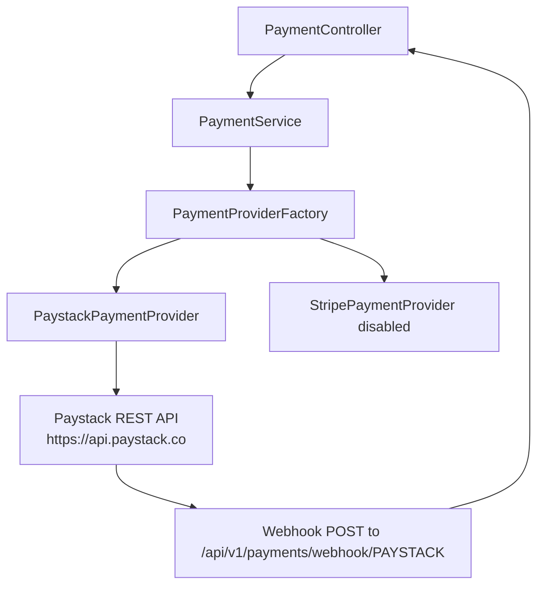

# Design Document: Paystack Provider Integration

## Overview

This design describes the implementation of Paystack as a payment provider in the RainCheque ticketing system. The integration follows the existing `PaymentProvider` abstraction, mirroring the pattern established by `StripePaymentProvider`. Since Paystack has no official Java SDK, the implementation uses Spring's `RestClient` (Spring 6.1+) to call Paystack's REST API directly with Bearer token authentication.

The scope covers:
- Adding `PAYSTACK` to the `PaymentProviderType` enum
- Creating `PaystackPaymentProvider` implementing the `PaymentProvider` interface
- Paystack API operations: initialize transaction, verify transaction, create refund
- Webhook signature verification using HMAC SHA-512
- Configuration binding via `application.yml` and environment variables
- Making Paystack the default provider (disabling Stripe)
- Updating the webhook controller to handle provider-specific signature headers

No frontend changes are required — the existing checkout flow redirects to whichever `checkoutUrl` the provider returns.

## Architecture



**Key architectural decisions:**

1. **RestClient over WebClient**: The existing codebase is synchronous (servlet-based Spring MVC). `RestClient` provides a fluent synchronous HTTP client that aligns with the thread-per-request model. No need for reactive infrastructure.

2. **No SDK dependency**: Paystack has no official Java SDK. Using `RestClient` with simple response DTOs keeps the dependency footprint minimal and avoids unmaintained third-party wrappers.

3. **Same conditional registration pattern**: The provider is annotated with `@ConditionalOnProperty(name = "payment.providers.PAYSTACK.enabled", havingValue = "true")` so it is only instantiated when configured, matching the Stripe approach.

4. **Amount in kobo**: Paystack expects amounts in the smallest currency unit (kobo for ZAR = cents). The conversion multiplies by 100, identical to how Stripe handles cents.

## Components and Interfaces

### New Components

| Component | Type | Package | Responsibility |
|-----------|------|---------|----------------|
| `PaystackPaymentProvider` | `@Component` | `com.raincheque.payment.provider.paystack` | Implements `PaymentProvider`; all Paystack API communication |
| `PaystackApiClient` | Internal helper | Same package | Encapsulates `RestClient` calls and response deserialization |
| `PaystackInitializeResponse` | Record | Same package | Maps JSON from `POST /transaction/initialize` |
| `PaystackVerifyResponse` | Record | Same package | Maps JSON from `GET /transaction/verify/:reference` |
| `PaystackRefundResponse` | Record | Same package | Maps JSON from `POST /refund` |
| `PaystackWebhookPayload` | Record | Same package | Deserializes webhook request body |

### Modified Components

| Component | Change |
|-----------|--------|
| `PaymentProviderType` | Add `PAYSTACK` constant |
| `PaymentController` | Accept `x-paystack-signature` header for PAYSTACK webhooks |
| `application.yml` | Add PAYSTACK config block, set `default-provider: PAYSTACK`, disable Stripe |
| `.env.example` | Add `PAYSTACK_SECRET_KEY` and `PAYSTACK_WEBHOOK_SECRET` entries |

### Interface Contract (unchanged)

`PaystackPaymentProvider` implements all methods from `PaymentProvider`:

```java
PaymentResponse createCheckoutSession(PaymentRequest request) throws PaymentException;
PaymentResponse verifyPayment(String providerReference) throws PaymentException;
PaymentResponse refundPayment(String providerReference, RefundRequest request) throws PaymentException;
PaymentResponse cancelPayment(String providerReference) throws PaymentException;
PaymentResponse retrievePayment(String providerReference) throws PaymentException;
List<PaymentResponse> getPaymentHistory(String providerReference) throws PaymentException;
PaymentWebhookEvent constructWebhookEvent(String payload, String signature) throws PaymentException;
PaymentProviderType getProviderType(); // returns PAYSTACK
```

### PaystackApiClient (internal)

```java
class PaystackApiClient {
    private final RestClient restClient;

    PaystackApiClient(String secretKey) {
        this.restClient = RestClient.builder()
                .baseUrl("https://api.paystack.co")
                .defaultHeader("Authorization", "Bearer " + secretKey)
                .defaultHeader("Content-Type", "application/json")
                .build();
    }

    PaystackInitializeResponse initializeTransaction(Map<String, Object> body);
    PaystackVerifyResponse verifyTransaction(String reference);
    PaystackRefundResponse createRefund(Map<String, Object> body);
}
```

### Webhook Header Resolution

The `PaymentController` will be updated to resolve the signature header dynamically:

```java
@PostMapping("/webhook/{provider}")
public ResponseEntity<Void> handleWebhook(
        @PathVariable PaymentProviderType provider,
        @RequestBody String payload,
        HttpServletRequest httpRequest) {
    String signature = resolveSignatureHeader(provider, httpRequest);
    if (signature == null || signature.isBlank()) {
        return ResponseEntity.badRequest().build();
    }
    // ... existing delegation logic
}

private String resolveSignatureHeader(PaymentProviderType provider, HttpServletRequest request) {
    return switch (provider) {
        case STRIPE -> request.getHeader("Stripe-Signature");
        case PAYSTACK -> request.getHeader("x-paystack-signature");
        default -> null;
    };
}
```

## Data Models

### Paystack API Response Models (internal, package-private)

```java
// POST /transaction/initialize response
record PaystackInitializeResponse(
    boolean status,
    String message,
    PaystackInitializeData data
) {
    record PaystackInitializeData(
        String authorization_url,
        String access_code,
        String reference
    ) {}
}

// GET /transaction/verify/:reference response
record PaystackVerifyResponse(
    boolean status,
    String message,
    PaystackVerifyData data
) {
    record PaystackVerifyData(
        String status,          // "success", "failed", "abandoned", "pending"
        String reference,
        long amount,            // in kobo
        String currency,
        String paid_at,         // ISO 8601 timestamp or null
        PaystackCustomer customer,
        PaystackMetadata metadata
    ) {}

    record PaystackCustomer(String email) {}
    record PaystackMetadata(String eventId, String ticketId) {}
}

// POST /refund response
record PaystackRefundResponse(
    boolean status,
    String message,
    PaystackRefundData data
) {
    record PaystackRefundData(
        String status,
        long amount,
        String currency,
        String transaction_reference
    ) {}
}
```

### Paystack Webhook Payload Model

```java
record PaystackWebhookPayload(
    String event,       // "charge.success", "charge.failed", "refund.processed"
    PaystackWebhookData data
) {
    record PaystackWebhookData(
        String reference,
        String status,
        long amount,
        String currency,
        String paid_at
    ) {}
}
```

### Status Mapping

| Paystack Status | Platform PaymentStatus |
|----------------|----------------------|
| `"success"` | `SUCCESS` |
| `"failed"` | `FAILED` |
| `"abandoned"` | `CANCELLED` |
| `"pending"` | `PROCESSING` |
| (webhook) `"charge.success"` | `SUCCESS` |
| (webhook) `"charge.failed"` | `FAILED` |
| (webhook) `"refund.processed"` | `REFUNDED` |

### Configuration Model (application.yml addition)

```yaml
payment:
  default-provider: PAYSTACK
  providers:
    PAYSTACK:
      enabled: true
      api-key: ${PAYSTACK_SECRET_KEY:}
      webhook-secret: ${PAYSTACK_WEBHOOK_SECRET:}
    STRIPE:
      enabled: false
      # ... existing config
```

## Correctness Properties

*A property is a characteristic or behavior that should hold true across all valid executions of a system — essentially, a formal statement about what the system should do. Properties serve as the bridge between human-readable specifications and machine-verifiable correctness guarantees.*

### Property 1: Amount conversion round-trip

*For any* valid payment amount in rands (BigDecimal with up to 2 decimal places), converting to kobo (multiply by 100, truncate to long) and converting back (divide by 100) SHALL produce the original amount.

**Validates: Requirements 3.1, 5.1, 8.1**

### Property 2: Status mapping is total and deterministic

*For any* Paystack transaction status string in the set {"success", "failed", "abandoned", "pending"} and any webhook event type in the set {"charge.success", "charge.failed", "refund.processed"}, the mapping function SHALL return a non-null PaymentStatus value, and calling the function twice with the same input SHALL produce the same output.

**Validates: Requirements 4.2, 4.3, 4.4, 4.5, 7.3, 7.4, 7.5**

### Property 3: Webhook HMAC verification rejects tampered payloads

*For any* valid webhook payload and secret key, computing the HMAC SHA-512 signature and then modifying any single byte of the payload SHALL cause signature verification to fail.

**Validates: Requirements 7.1, 7.2**

### Property 4: Error sanitization never leaks secret keys

*For any* string containing a Paystack secret key pattern (matching `sk_live_*` or `sk_test_*`), the sanitize function SHALL return a string that does not contain any substring matching those patterns.

**Validates: Requirements 10.1, 10.2, 10.3**

### Property 5: Checkout session always produces a valid response with PENDING status

*For any* valid PaymentRequest (non-null email, positive amount, valid URLs), when the Paystack API returns a successful initialization response, the resulting PaymentResponse SHALL have status PENDING, a non-null checkoutUrl, and providerName equal to "PAYSTACK".

**Validates: Requirements 3.2, 3.4**

### Property 6: Cancel rejects completed transactions

*For any* transaction whose verified status is "success", calling cancelPayment SHALL throw a PaymentException.

**Validates: Requirements 6.2**

## Error Handling

### Error Categories

| Category | Source | Handling |
|----------|--------|----------|
| Network failures | RestClient timeout/connection errors | Wrap in `PaymentException` with sanitized message |
| API errors | Paystack returns `status: false` | Extract `message` field, sanitize, throw `PaymentException` |
| Signature mismatch | HMAC comparison fails | Throw `PaymentException("Webhook signature verification failed")` |
| Invalid state transitions | Cancel on completed payment | Throw `PaymentException` with descriptive message |
| Missing credentials | Startup validation | `IllegalStateException` via `PaymentProperties.validateCredentials()` |

### Sanitization Strategy

Replicates the Stripe provider's approach:
1. Strip patterns matching `sk_live_*`, `sk_test_*` (Paystack secret keys)
2. Strip internal Paystack transaction/reference IDs if they appear in error messages
3. If any `[REDACTED]` marker remains, replace entire message with generic fallback

### Retry Policy

No automatic retries at the provider level. The caller (PaymentService) owns retry decisions. Paystack's API is idempotent for verify operations but NOT for initialize — each call creates a new transaction. The unique reference generated per request prevents duplicate charges.

### Timeout Configuration

RestClient is configured with:
- Connect timeout: 5 seconds
- Read timeout: 30 seconds

These are reasonable defaults for payment API calls. Configurable via provider properties if needed later.

## Testing Strategy

### Unit Tests

- **PaystackPaymentProvider**: Mock `PaystackApiClient` to test each method in isolation:
  - `createCheckoutSession` — verify request body construction (kobo conversion, metadata, reference generation)
  - `verifyPayment` — verify status mapping for each Paystack status string
  - `refundPayment` — verify amount conversion and response mapping
  - `cancelPayment` — verify rejection of completed payments, acceptance of pending
  - `constructWebhookEvent` — verify HMAC computation, event type mapping, reference extraction
  - `sanitizeErrorMessage` — verify all secret key patterns are stripped
- **PaymentController webhook header**: Verify correct header is read per provider type
- **Configuration validation**: Verify startup fails with missing credentials

### Property-Based Tests (fast-check style with jqwik)

The project uses Java 17 with Spring Boot. **jqwik** is the standard PBT library for JUnit 5 / Java:

- Each property test runs **minimum 100 iterations**
- Each test is tagged with a comment: `// Feature: paystack-provider-integration, Property N: <text>`
- Properties 1–6 above are each implemented as a single `@Property` test

**Library**: `net.jqwik:jqwik:1.9.x` (JUnit 5 compatible)

### Integration Tests

- **Spring Boot integration test** with `@SpringBootTest` verifying:
  - `PaystackPaymentProvider` is registered in the factory when enabled
  - Provider is excluded when disabled
  - Configuration validation throws on missing credentials
- **WireMock integration tests** simulating Paystack API responses for the full flow:
  - Initialize → verify → refund lifecycle
  - Error responses (4xx, 5xx)
  - Webhook delivery with valid/invalid signatures

### Test Environment

- No real Paystack API calls in CI — all external calls mocked via WireMock or Mockito
- `application-test.yml` configures PAYSTACK with test credentials
- Webhook tests generate real HMAC signatures using a known test secret
