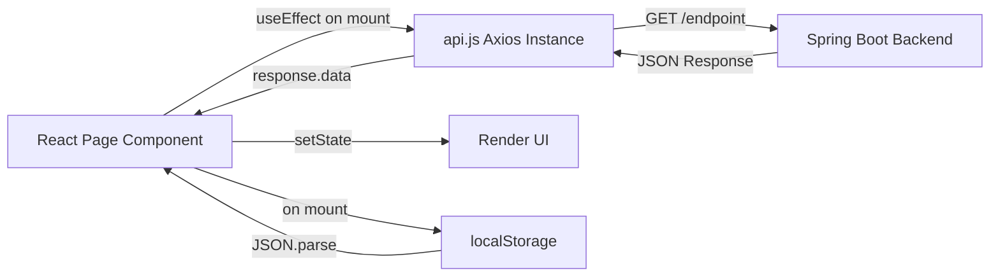
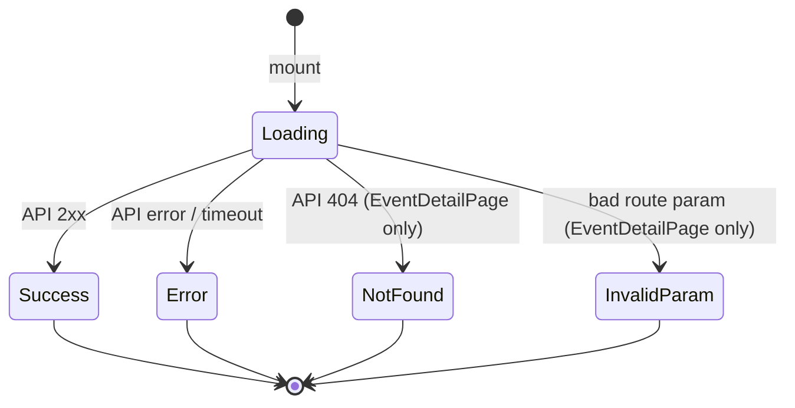

# Design Document: Replace Mock Data with API

## Overview

This design describes the changes needed to remove all inline mock data and hardcoded values from four React page components (EventDetailPage, TicketsPage, DashboardPage, ProfilePage) and replace them with real API calls to the Spring Boot backend or localStorage reads where no backend endpoint exists.

The approach is minimal and surgical: each page keeps its existing HTML structure, Tailwind classes, and component nesting. Only the data-fetching layer changes. The pages transition from a "try API, fall back to mock" pattern to a "call API, show loading/error states" pattern.

### Key Design Decisions

| Decision | Rationale |
|----------|-----------|
| Use existing `api.js` Axios instance for all HTTP calls | Already configured with base URL, auth interceptor, 401 redirect, and timeout |
| Read user data from `localStorage('user')` on DashboardPage and ProfilePage | No dedicated `/users/me` endpoint exists; localStorage is already populated at login |
| Remove mock data entirely rather than feature-flagging it | Requirements explicitly forbid mock fallbacks; MSW in `src/mocks/` covers dev-only mocking |
| Validate route params client-side before API call | Prevents unnecessary network round-trips for obviously invalid IDs |
| Keep `src/mocks/` directory intact | MSW setup is for dev-time API simulation, not in-component fallbacks |

## Architecture

The data flow follows a simple unidirectional pattern:



### Component State Machine (per page)

Each page follows the same state lifecycle:



## Components and Interfaces

### Modified Components

#### 1. EventDetailPage (`src/pages/EventDetailPage.jsx`)

**Removed:**
- `mockEvents` object (entire ~130 line definition)
- `usingMockData` state variable
- Mock data indicator UI (`<div>Using demo data...`)
- Inner try/catch that assigns mock data on API failure
- Mock fallback in `handleBookNow` and `handlePayment`

**Changed:**
- `fetchEventDetails()` becomes a single `api.get(`/events/${id}`)` call with no fallback
- Add route param validation: if `id` is not a valid positive integer (`/^\d+$/` test), set error state immediately
- Distinguish 404 from other errors: check `err.response?.status === 404` to show "Event not found" message
- Keep `loading`, `error`, `event` state variables with same semantics

**Interface contract with backend:**
```typescript
// GET /api/v1/events/{id} → EventResponse
interface EventResponse {
  id: number;
  title: string;
  description: string;
  shortDescription: string;
  venueName: string;
  venueCity: string;
  venueAddress: string;
  startTime: string; // ISO 8601
  endTime: string;
  category: string;
  bannerImageUrl: string;
  thumbnailUrl: string;
  status: string;
  featured: boolean;
  ticketTiers: TicketTierDto[];
  minPrice: number;
  maxPrice: number;
  metadata: EventMetadata;
  totalAvailableTickets: number;
}

interface TicketTierDto {
  id: number;
  name: string;
  description: string;
  price: number;
  remainingQuantity: number;
  totalQuantity: number;
  maxPerUser: number;
  minPerUser: number;
  benefits: string[];
  active: boolean;
}
```

#### 2. TicketsPage (`src/pages/TicketsPage.jsx`)

**Removed:**
- `mockTickets` array inside `fetchTickets()`
- Inner try/catch that assigns mock data
- Mock download logic (text file generation in `handleDownload`)
- Mock download logic in `handleDownloadAll`

**Changed:**
- `fetchTickets()` becomes a single `api.get('/tickets')` with error propagation
- `handleDownload(ticketId)` calls `api.get(`/tickets/${ticketId}/download`, { responseType: 'blob' })` and triggers file save; on error, shows appropriate message based on status code
- `handleDownloadAll()` groups tickets by `booking.id`, calls `api.get(`/tickets/booking/${bookingId}/download`, { responseType: 'blob' })` per group; on error shows message

**Interface contract with backend:**
```typescript
// GET /api/v1/tickets → Ticket[]
interface Ticket {
  id: number;
  ticketCode: string;
  status: 'ACTIVE' | 'USED' | 'REFUNDED' | 'CANCELLED';
  pricePaid: number;
  seatNumber: string | null;
  ticketTier: { name: string };
  booking: {
    id: number;
    event: {
      id: number;
      title: string;
      startTime: string;
      venue: { name: string; city: string };
    };
  };
  qrSecret: string;
}

// GET /api/v1/tickets/{ticketId}/download → Blob (application/pdf)
// GET /api/v1/tickets/booking/{bookingId}/download → Blob (application/pdf)
```

#### 3. DashboardPage (`src/pages/DashboardPage.jsx`)

**Removed:**
- Hardcoded `user` object with literal `fullName`, `email`, `memberSince` values
- Hardcoded `upcomingEvents: 3`, `pastEvents: 4`, wishlist `5`

**Added:**
- `useState` and `useEffect` hooks (currently a stateless component)
- `useNavigate` for redirect on missing user
- `loading` and `error` state for the tickets API call
- Read `localStorage.getItem('user')` → `JSON.parse()` on mount
- If user is null/missing → `navigate('/login')`
- `api.get('/tickets')` to derive `ticketCount = response.data.length`

**Changed:**
- Stats grid shows only "Tickets Purchased" with real count; "Upcoming Events" and "Wishlist" stats are removed per requirements
- Welcome header uses `user.fullName` from localStorage
- `memberSince` field is kept if present in localStorage user object, otherwise hidden

#### 4. ProfilePage (`src/pages/ProfilePage.jsx`)

**Removed:**
- Hardcoded initial state `fullName: 'John Doe'`, `email: 'john@example.com'`, `phone: '+1 234 567 8900'`

**Added:**
- `useEffect` on mount to read `localStorage.getItem('user')` → `JSON.parse()`
- `useNavigate` for redirect when user data is invalid/missing
- Validation logic: `fullName` must be 1–100 chars, `email` must match a basic email regex
- `validationErrors` state object for inline field errors
- `successMessage` state with 3-second auto-dismiss
- On save: update localStorage user object (merge new fields, preserve `role` and other existing fields)

**Changed:**
- Form initial state comes from parsed localStorage user
- `handleSubmit` validates → updates localStorage → shows success message
- Phone field defaults to empty string (not stored in localStorage user)

### Unchanged Components

- `LoadingSpinner` — used as-is with `fullPage` prop
- `ErrorAlert` — used as-is with `message` and `onClose` props
- `TicketCard` — used as-is; ticket data shape from API matches existing prop expectations
- `src/services/api.js` — no changes needed
- `src/mocks/browser.js` and `src/mocks/handlers.js` — retained, not modified

## Data Models

### localStorage User Object

```json
{
  "fullName": "Khanyo Railo",
  "email": "khanyo@example.com",
  "role": "USER"
}
```

This is set at login time and read by DashboardPage and ProfilePage. ProfilePage may update `fullName`, `email`, and add `phone`.

### API Response Shapes

All API responses use the shapes already defined by the Spring Boot backend. No new DTOs or response wrappers are needed. The frontend maps backend field names directly to UI template positions:

| Backend Field | UI Location |
|---------------|-------------|
| `EventResponse.title` | Event header overlay text |
| `EventResponse.venueName` | Quick info card "Venue" |
| `EventResponse.ticketTiers[].price` | Tier card price display |
| `EventResponse.ticketTiers[].remainingQuantity` | "X seats left" text |
| `Ticket[].ticketCode` | TicketCard code badge |
| `Ticket[].booking.event.title` | TicketCard header |
| `Ticket[].booking.event.startTime` | TicketCard date/time |
| `Ticket[].booking.event.venue.name` | TicketCard venue |

### QR Code Display

The current TicketCard renders `ticket.qrCode` as an image URL. The backend provides `qrSecret` (a string), not a pre-rendered QR URL. The TicketCard will need to generate the QR code URL client-side:

```javascript
// Generate QR code URL from qrSecret
const qrCodeUrl = `https://api.qrserver.com/v1/create-qr-code/?size=150x150&data=${encodeURIComponent(ticket.qrSecret)}`;
```

This mapping happens in TicketsPage when passing props to TicketCard, keeping TicketCard itself unchanged.

## Error Handling

### Error Classification by Page

| Page | Error Source | Handling |
|------|-------------|----------|
| EventDetailPage | 404 response | "Event not found" distinct message |
| EventDetailPage | Invalid route param | "Invalid event ID" error, no API call |
| EventDetailPage | Other HTTP errors | Generic ErrorAlert with message |
| TicketsPage | GET /tickets failure | ErrorAlert, empty ticket list |
| TicketsPage | Download 404 | "Ticket not found" inline message |
| TicketsPage | Download 401 | "Not authorized" inline message |
| TicketsPage | Download 403 | "Access denied" inline message |
| TicketsPage | Download timeout | "Request timed out" inline message |
| DashboardPage | GET /tickets failure | Show 0 for ticket count, error in stats section |
| DashboardPage | No user in localStorage | Redirect to `/login` |
| ProfilePage | No/invalid user in localStorage | Redirect to `/login` |
| ProfilePage | Validation failure | Inline field errors, no save |

### Error Message Patterns

```javascript
// Download error classification (TicketsPage)
if (err.code === 'ECONNABORTED') {
  message = 'Request timed out. Please try again.';
} else if (err.response?.status === 404) {
  message = 'Ticket not found.';
} else if (err.response?.status === 401) {
  message = 'You are not authorized to download this ticket.';
} else if (err.response?.status === 403) {
  message = 'Access denied.';
} else if (err.response?.status) {
  message = `Server error: ${err.response.status}`;
} else {
  message = 'No response from server. Please check your connection.';
}
```

### localStorage Validation (ProfilePage & DashboardPage)

```javascript
const readUserFromStorage = (navigate) => {
  const raw = localStorage.getItem('user');
  if (!raw || raw.trim() === '') {
    navigate('/login');
    return null;
  }
  try {
    const parsed = JSON.parse(raw);
    if (!parsed || typeof parsed !== 'object') {
      navigate('/login');
      return null;
    }
    return parsed;
  } catch {
    navigate('/login');
    return null;
  }
};
```

## Testing Strategy

### Why Property-Based Testing Does Not Apply

This feature involves:
- Wiring React UI components to existing REST endpoints (no complex transformations)
- Reading/writing localStorage (simple serialization of known structure)
- Rendering API responses into existing templates (straightforward mapping)
- Removing dead code (mock objects)

There are no pure functions with variable input spaces, no parsers, no serializers with complex round-trip guarantees, and no algorithmic logic. The behavior is deterministic given a fixed API response. PBT would not find bugs that example-based tests miss here.

### Recommended Testing Approach

**Unit Tests (with mocked API via MSW or jest mocks):**

| Test | Validates |
|------|-----------|
| EventDetailPage renders event data from API response | Req 1.3 |
| EventDetailPage shows loading spinner during fetch | Req 1.2 |
| EventDetailPage shows error on non-404 failure | Req 1.4 |
| EventDetailPage shows "Event not found" on 404 | Req 1.6 |
| EventDetailPage shows error for invalid route param (e.g. "abc") | Req 1.7 |
| EventDetailPage has no `mockEvents` or `usingMockData` | Req 1.5, 5.1, 5.5 |
| TicketsPage renders tickets from API response | Req 2.3 |
| TicketsPage shows empty state when array is empty | Req 2.10 |
| TicketsPage shows error on fetch failure | Req 2.4 |
| TicketsPage triggers PDF download on button click | Req 2.5, 2.6 |
| TicketsPage shows correct error message per status code | Req 2.9 |
| TicketsPage has no `mockTickets` | Req 2.8, 5.2 |
| DashboardPage reads user from localStorage | Req 3.1 |
| DashboardPage fetches ticket count from API | Req 3.2 |
| DashboardPage redirects to login when no user | Req 3.6 |
| DashboardPage has no hardcoded user object | Req 3.7, 5.3 |
| ProfilePage reads user from localStorage | Req 4.1 |
| ProfilePage redirects on missing/invalid user | Req 4.4 |
| ProfilePage validates fullName (1–100 chars) | Req 4.6 |
| ProfilePage validates email format | Req 4.6 |
| ProfilePage saves to localStorage preserving existing fields | Req 4.5 |
| ProfilePage shows success message for 3+ seconds | Req 4.5 |
| ProfilePage has no hardcoded placeholders | Req 4.3, 5.4 |

**Integration Tests (against running backend or MSW):**

| Test | Validates |
|------|-----------|
| Full EventDetailPage load with real event ID | Req 1.1–1.3 |
| Full TicketsPage load and single download | Req 2.1–2.6 |
| Full batch download flow | Req 2.7 |

**Testing Tools:**
- Vitest + React Testing Library for unit tests
- MSW (already in project at `src/mocks/`) for API mocking in tests
- `@testing-library/user-event` for click/submit simulations

**Test Configuration:**
- Each test file co-located with component: `EventDetailPage.test.jsx`, etc.
- MSW handlers configured per test suite to return specific responses
- localStorage mocked via `beforeEach` setup/teardown

