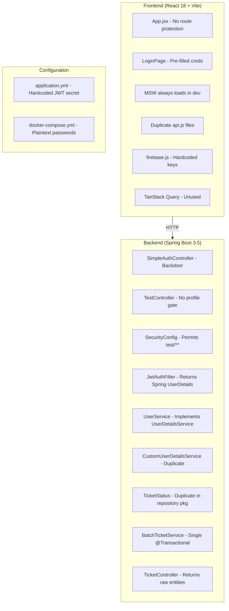
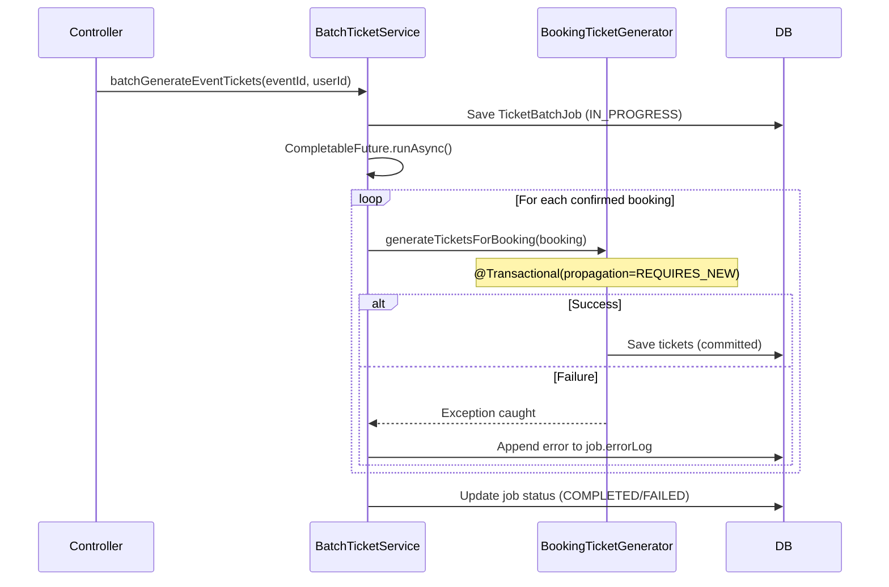

# Design Document: Security Hardening & Cleanup

## Overview

This design covers a comprehensive security hardening and code cleanup effort for the RainCheque ticketing application. The scope spans four domains:

1. **Security** (Reqs 1–5): Externalize secrets, remove backdoors, protect routes, fix auth flow
2. **Architecture** (Reqs 6–8): Enum consolidation, UserDetailsService unification, @AuthenticationPrincipal fix
3. **Best Practices** (Reqs 9–16): MSW gating, dead dependency removal, exception handling, DTOs, transaction fix, error boundary, code splitting
4. **Deployment** (Reqs 17–21): Dockerfiles, health checks, Spring profiles, dead code removal, CI/CD

The changes affect both the Spring Boot 3.5 backend (Java 17, Maven, JWT auth, JPA) and the React 18 frontend (Vite, Axios, TailwindCSS, react-router-dom v6).

## Architecture

### Current State



### Target State

```mermaid
graph TB
    subgraph Frontend["Frontend (React 18 + Vite)"]
        AuthCtx[AuthContext Provider]
        ProtRoute[ProtectedRoute Wrapper]
        ErrBound[Error Boundary]
        Suspense[Suspense + Lazy Routes]
        SingleApi[Single api.js in services/]
        MockGate[MSW gated by VITE_ENABLE_MOCKS]
    end

    subgraph Backend["Backend (Spring Boot 3.5)"]
        SecConfig2[SecurityConfig - Strict permitAll]
        JwtFilter2[JwtAuthFilter - Sets JPA User as principal]
        SingleUDS[Single UserDetailsService]
        SingleEnum[Single TicketStatus in entity pkg]
        BatchSvc2[BatchTicketService - Per-booking transactions]
        GlobalExc[GlobalExceptionHandler]
        DTOs[TicketResponse DTO layer]
        HealthEp[/actuator/health endpoint]
        Profiles[Spring Profiles - dev/prod]
    end

    subgraph Deployment["Deployment"]
        DockerBE[Backend Dockerfile - Multi-stage]
        DockerFE[Frontend Dockerfile - Multi-stage]
        CICD[GitHub Actions Workflows]
        EnvExample[.env.example + .gitignore]
    end

    Frontend -->|HTTP + JWT| Backend
    Backend --> Profiles
    DockerBE --> Backend
    DockerFE --> Frontend
```

## Components and Interfaces

### Backend Components

#### 1. Secrets & Configuration Layer

| Component | Change | Location |
|-----------|--------|----------|
| `application.yml` | Remove hardcoded JWT secret & QR secret; use `${SPRING_SECURITY_JWT_SECRET}` and `${APP_QR_SECRET}` with NO default | `src/main/resources/application.yml` |
| `application-dev.yml` | H2 config, create-drop ddl-auto, H2 console enabled | `src/main/resources/application-dev.yml` |
| `application-prod.yml` | PostgreSQL via env vars, validate ddl-auto, show-sql=false | `src/main/resources/application-prod.yml` |
| `SecretsValidationConfig` | `@Configuration` class with `@PostConstruct` validation that fails startup if required env vars are missing in prod | `config/SecretsValidationConfig.java` |

**Design Decision**: Using `@PostConstruct` in a `@Configuration` class rather than custom `ApplicationRunner` because it fires during context initialization (before accepting HTTP requests), satisfying Requirement 1.5.

#### 2. Security Layer

| Component | Change | Location |
|-----------|--------|----------|
| `SimpleAuthController` | DELETE entirely | `controller/SimpleAuthController.java` |
| `TestController` | Add `@Profile("dev")`, remove password hash/plaintext from responses | `controller/TestController.java` |
| `SecurityConfig` | Remove `/api/v1/test/**` permitAll, add `/actuator/health` permitAll, remove simple-auth path | `config/SecurityConfig.java` |
| `JwtAuthenticationFilter` | Load JPA `User` entity as principal (not Spring Security `User` DTO), remove `/api/v1/test/` skip | `security/JwtAuthenticationFilter.java` |
| `CustomUserDetailsService` | Refactor to be the SOLE `UserDetailsService` implementation; remove `UserService.loadUserByUsername()` | `security/CustomUserDetailsService.java` |

**Design Decision**: The `JwtAuthenticationFilter` will create a `UsernamePasswordAuthenticationToken` with the JPA `User` entity as the principal. This allows `@AuthenticationPrincipal User user` in controllers to inject the entity directly, eliminating the need for additional DB lookups.

#### 3. Exception Handling Layer

| Component | Purpose |
|-----------|---------|
| `GlobalExceptionHandler` | `@ControllerAdvice` catching all exceptions |
| `ErrorResponse` | Standard error DTO: `{timestamp, status, error, message, fieldErrors?}` |

Handler mappings:
- `ResourceNotFoundException` → 404
- `MethodArgumentNotValidException` / `ConstraintViolationException` → 400 with field errors
- `AccessDeniedException` → 403
- `AuthenticationException` → 401
- `Exception` (catch-all) → 500 with generic message

In non-dev profiles, the `message` field uses a generic string and never includes class names, stack traces, SQL, or internal paths.

#### 4. DTO Layer

| DTO | Fields | Excludes |
|-----|--------|----------|
| `TicketResponse` | id, ticketCode, status, seatNumber, pricePaid, usedAt, eventName, tierName, bookingId | qrSecret, hibernate proxies, nested JPA entities |
| `TicketValidationResponse` | valid, message, ticket (as `TicketResponse`) | Raw Ticket entity |

Mapping will use a static factory method (`TicketResponse.from(Ticket)`) rather than MapStruct for this limited scope — fewer moving parts and the mapping is straightforward.

#### 5. Batch Ticket Service (Transaction Fix)

Current problem: The entire `batchGenerateEventTickets` method is `@Transactional`, but it runs inside `CompletableFuture.supplyAsync()` which executes on a different thread — Spring's `@Transactional` proxy doesn't apply to code running on a non-Spring-managed thread.

**Solution Architecture**:



**Design Decision**: Extract per-booking ticket generation into a separate Spring bean (`BookingTicketGenerator`) annotated with `@Transactional(propagation = Propagation.REQUIRES_NEW)`. This ensures each booking gets its own transaction that commits independently. The outer async method catches exceptions per-booking and records failures without rolling back the entire batch.

#### 6. Health & Actuator

- Add `spring-boot-starter-actuator` dependency to `pom.xml`
- Configure `management.endpoints.web.exposure.include=health` (only health)
- Add `/actuator/health` to SecurityConfig's `permitAll()` matchers
- Default health indicators (disk space, db) will report status

### Frontend Components

#### 7. Auth Context & Protected Routes

```
src/
├── context/
│   └── AuthContext.jsx        # createContext + AuthProvider
├── components/
│   ├── ProtectedRoute.jsx     # Redirects to /login if !isAuthenticated
│   └── ErrorBoundary.jsx      # Class component error boundary
```

`AuthContext` API:
- `token` — JWT string from localStorage
- `user` — `{id, email, fullName, role}` from localStorage
- `isAuthenticated` — boolean derived from token presence
- `login(token, user)` — stores to localStorage, redirects to saved path
- `logout()` — clears localStorage, redirects to /login

`ProtectedRoute` wraps `/dashboard`, `/tickets`, `/profile` routes. It reads `isAuthenticated` from context. If false, it saves `location.pathname` and redirects to `/login`.

The Axios response interceptor (already partially implemented in `api.js`) will call `logout()` on 401 responses.

#### 8. Error Boundary

React class component that:
- Catches errors via `componentDidCatch` / `getDerivedStateFromError`
- Renders fallback UI with a generic message (≤150 chars), "Try Again" button, and "Go Home" link
- "Try Again" resets `hasError` state, triggering re-render of children
- If re-render fails, fallback shows again (no infinite loop because `getDerivedStateFromError` is synchronous and React batches renders)

#### 9. Route-Based Code Splitting

```jsx
// Lazy-loaded (authenticated/data-heavy)
const DashboardPage = React.lazy(() => import('./pages/DashboardPage'));
const TicketsPage = React.lazy(() => import('./pages/TicketsPage'));
const ProfilePage = React.lazy(() => import('./pages/ProfilePage'));
const EventsPage = React.lazy(() => import('./pages/EventsPage'));
const EventDetailPage = React.lazy(() => import('./pages/EventDetailPage'));

// Kept in main bundle (lightweight/public)
import HomePage from './pages/HomePage';
import LoginPage from './pages/LoginPage';
import RegisterPage from './pages/RegisterPage';
import NotFoundPage from './pages/NotFoundPage';
```

A `<Suspense fallback={<LoadingSpinner />}>` wraps the route outlet. A chunk-load error boundary (can reuse the main ErrorBoundary or a specialized `ChunkErrorBoundary`) catches dynamic import failures and provides a retry button.

#### 10. MSW Gating

```jsx
async function enableMocking() {
  if (import.meta.env.PROD) return;
  if (import.meta.env.VITE_ENABLE_MOCKS !== 'true') return;
  
  try {
    const { worker } = await import('./mocks/browser');
    return worker.start({ onUnhandledRequest: 'bypass' });
  } catch (error) {
    console.warn('MSW failed to start:', error);
  }
}
```

#### 11. Dead Code & Dependency Cleanup

Files to remove:
- `src/api.js` (duplicate Axios instance)
- `src/test-api.js` (manual test script)
- `src/mocks/` directory (MSW handlers — if mocks are not retained)
- `src/firebase.js` (hardcoded Firebase config, app uses JWT exclusively)
- `firebase` npm package from `package.json`
- `@tanstack/react-query` and `@tanstack/react-query-devtools` from `package.json` (no source files import from it — or integrate it properly)
- `QueryClientProvider` and `QueryClient` from `main.jsx`
- `backend-spring/rain-cheque-backend/debug-log.txt`

**Design Decision on TanStack Query**: Current inspection shows `@tanstack/react-query` is imported in `main.jsx` (QueryClientProvider) but no page components use `useQuery` or `useMutation`. Decision: **Remove** TanStack Query entirely and use the existing Axios-based service pattern consistently.

**Design Decision on MSW**: The mocks directory will be **retained** (gated by VITE_ENABLE_MOCKS) since it's useful for offline development. Only the unconditional loading in main.jsx is fixed.

### Deployment Components

#### 12. Backend Dockerfile

```dockerfile
# Stage 1: Build
FROM eclipse-temurin:17-jdk AS build
WORKDIR /app
COPY .mvn .mvn
COPY mvnw pom.xml ./
RUN ./mvnw dependency:go-offline -B
COPY src ./src
RUN ./mvnw package -DskipTests -B

# Stage 2: Runtime
FROM eclipse-temurin:17-jre-alpine
RUN addgroup -S app && adduser -S app -G app
WORKDIR /app
COPY --from=build /app/target/*.jar app.jar
USER app
EXPOSE 8081
ENTRYPOINT ["java", "-jar", "app.jar"]
```

#### 13. Frontend Dockerfile

```dockerfile
# Stage 1: Build
FROM node:20-alpine AS build
WORKDIR /app
COPY package.json package-lock.json ./
RUN npm ci
COPY . .
RUN npm run build

# Stage 2: Runtime
FROM nginx:alpine
COPY --from=build /app/dist /usr/share/nginx/html
COPY nginx.conf /etc/nginx/conf.d/default.conf
EXPOSE 80
```

#### 14. GitHub Actions Workflows

Two workflow files:
- `.github/workflows/backend-ci.yml` — Java 17, Maven build & test
- `.github/workflows/frontend-ci.yml` — Node 20, install, lint, build

Both trigger on pull_request to main.

## Data Models

### ErrorResponse (New)

```java
public record ErrorResponse(
    Instant timestamp,
    int status,
    String error,
    String message,
    List<FieldError> fieldErrors  // nullable, only for validation errors
) {
    public record FieldError(String field, String message) {}
}
```

### TicketResponse DTO (New)

```java
public record TicketResponse(
    Long id,
    String ticketCode,
    String status,
    String seatNumber,
    BigDecimal pricePaid,
    LocalDateTime usedAt,
    String eventName,
    String tierName,
    Long bookingId
) {
    public static TicketResponse from(Ticket ticket) {
        return new TicketResponse(
            ticket.getId(),
            ticket.getTicketCode(),
            ticket.getStatus().name(),
            ticket.getSeatNumber(),
            ticket.getPricePaid(),
            ticket.getUsedAt(),
            ticket.getBooking().getEvent().getName(),
            ticket.getTicketTier().getName(),
            ticket.getBooking().getId()
        );
    }
}
```

### TicketValidationResponse (Updated)

```java
public record TicketValidationResponse(
    boolean valid,
    String message,
    TicketResponse ticket  // Changed from Ticket entity
) {}
```

### Auth Context State (Frontend)

```typescript
interface AuthState {
  token: string | null;
  user: { id: number; email: string; fullName: string; role: string } | null;
  isAuthenticated: boolean;
  login: (token: string, user: UserInfo) => void;
  logout: () => void;
}
```

## Correctness Properties

*A property is a characteristic or behavior that should hold true across all valid executions of a system — essentially, a formal statement about what the system should do. Properties serve as the bridge between human-readable specifications and machine-verifiable correctness guarantees.*

### Property 1: Exception Response Structure Consistency

*For any* exception thrown by a controller method (whether RuntimeException, checked exception, or Spring-specific exception), the GlobalExceptionHandler SHALL return a JSON response body containing exactly the fields `timestamp`, `status`, `error`, and `message`, and the response body SHALL NOT contain Java class names, stack trace lines, SQL query strings, or internal file system paths.

**Validates: Requirements 12.2, 12.5**

### Property 2: Ticket DTO Mapping Completeness and Safety

*For any* Ticket entity with fully populated associations (booking, event, ticketTier), mapping to TicketResponse SHALL produce a DTO where: (a) the `id`, `ticketCode`, `status`, `seatNumber`, `pricePaid`, `usedAt`, `eventName`, `tierName`, and `bookingId` fields are non-null and match their source entity values, and (b) the serialized DTO JSON SHALL NOT contain the key `qrSecret` nor any JPA proxy class references.

**Validates: Requirements 13.1, 13.2, 13.3**

### Property 3: Batch Transaction Isolation

*For any* set of confirmed bookings where at least one booking's ticket generation throws an exception, the BatchTicketService SHALL preserve all tickets committed for non-failing bookings in the database, roll back only the tickets for the failing booking(s), and record error details in the TicketBatchJob's errorLog field.

**Validates: Requirements 14.1, 14.2, 14.4**

### Property 4: Batch Job Final Status Determination

*For any* completed batch ticket generation run, the TicketBatchJob status SHALL be COMPLETED if and only if all bookings were processed without exceptions, and SHALL be FAILED if one or more bookings encountered an exception during processing.

**Validates: Requirements 14.3**

## Error Handling

### Backend Error Handling Strategy

| Layer | Error Type | Handling |
|-------|-----------|----------|
| Controller | Validation errors | Caught by GlobalExceptionHandler → 400 |
| Controller | ResourceNotFoundException | Caught by GlobalExceptionHandler → 404 |
| Security | AccessDeniedException | Caught by GlobalExceptionHandler → 403 |
| Security | AuthenticationException | Caught by GlobalExceptionHandler → 401 |
| Service | Business logic exceptions | Caught by GlobalExceptionHandler → 500 (generic message) |
| BatchTicketService | Per-booking failures | Caught in async loop, logged to TicketBatchJob.errorLog |
| Startup | Missing env vars | @PostConstruct throws → context fails to initialize |

**Profile-based detail level**:
- `dev` profile: Include exception class name and message in response (aids debugging)
- `prod` profile: Generic "An unexpected error occurred" message for 500s

### Frontend Error Handling Strategy

| Layer | Error Type | Handling |
|-------|-----------|----------|
| API Interceptor | HTTP 401 | Clear auth, redirect to /login |
| API Interceptor | HTTP 4xx/5xx | Reject promise, let component handle |
| Error Boundary | Render crash | Show fallback UI with retry |
| Suspense | Chunk load failure | Show error with retry button |
| Auth Context | Expired token | On next API call → 401 → auto-logout |

## Testing Strategy

### Backend Testing

**Unit Tests** (JUnit 5 + Mockito):
- `GlobalExceptionHandler`: Test each exception type maps to correct HTTP status and response structure
- `TicketResponse.from()`: Test mapping with various entity states
- `SecretsValidationConfig`: Test startup failure with missing env vars
- `CustomUserDetailsService`: Test user loading and UsernameNotFoundException
- `BookingTicketGenerator`: Test per-booking transaction behavior with mocked repository

**Integration Tests** (Spring Boot Test + MockMvc):
- Security filter chain: Verify `/api/v1/simple-auth/**` returns 401/404
- Security filter chain: Verify `/api/v1/test/**` returns 404 in prod profile
- Security filter chain: Verify `/actuator/health` is publicly accessible
- `@AuthenticationPrincipal` resolution: Verify JPA User entity injection
- Health endpoint: Verify 200/UP response

**Property-Based Tests** (jqwik):
- **Property 1**: Generate random exceptions, verify response structure invariant
- **Property 2**: Generate random Ticket entities, verify DTO mapping invariant
- **Property 3**: Generate random booking sets with injected failures, verify transaction isolation
- **Property 4**: Generate random success/failure combinations, verify final status

Library: [jqwik](https://jqwik.net/) — the standard PBT library for JUnit 5 on the JVM. Configure minimum 100 iterations per property (`@Property(tries = 100)`).

Each property test MUST include a comment tag:
```java
// Feature: security-hardening-cleanup, Property {N}: {property text}
```

### Frontend Testing

**Unit Tests** (Vitest + React Testing Library):
- `AuthContext`: Test login/logout/isAuthenticated behavior
- `ProtectedRoute`: Test redirect for unauthenticated users
- `ErrorBoundary`: Test fallback rendering and retry behavior
- `LoginPage`: Test empty initial form state
- `main.jsx` mocking logic: Test VITE_ENABLE_MOCKS gating

**Build Verification**:
- `npm run build` succeeds after all dead code removal
- No console errors on app load

### Smoke Tests (Manual / CI verification):
- Backend starts without secrets → fails with clear error
- Backend starts with dev profile → H2 active
- Docker builds complete successfully
- GitHub Actions workflows pass on clean PR
